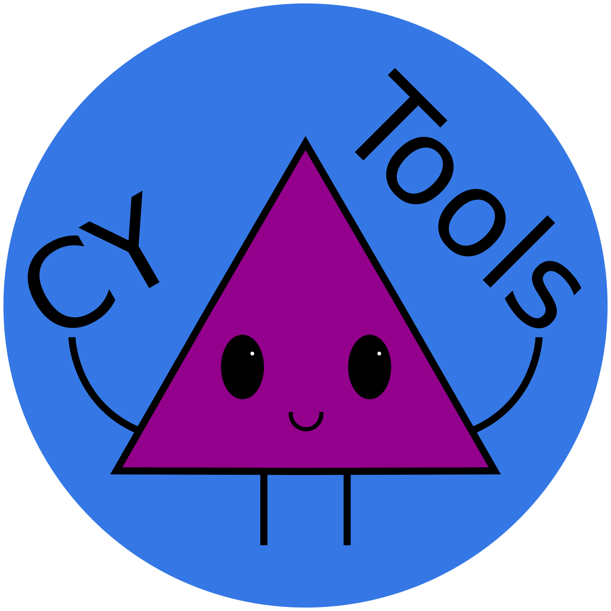

# About CYTools

{ width="250" }

**A software package for analyzing Calabi-Yau manifolds**

---

CYTools is an open-source software package developed by [Liam McAllister's group](https://liammcallistergroup.com/) with the purpose of studying Calabi-Yau manifolds arising from the Kreuzer-Skarke database. The founding authors are [Mehmet Demirtas](https://inspirehep.net/authors/1765325) and [Andres Rios-Tascon](https://ariostas.com); the current [BDFL](https://en.wikipedia.org/wiki/Benevolent_dictator_for_life) is [Nate MacFadden](https://inspirehep.net/authors/1590972). It emerged from several years of effort towards exploring previously uncharted parts of the string landscape. It offers vastly superior computational performance compared to other software typically used in the field, as discussed in the CYTools paper, [arXiv:2211.03823](https://arxiv.org/abs/2211.03823). Installation instructions can be found in the [Get started](getting-started/index.md) section, and the full reference in the [documentation](documentation/index.md).

Most of the code is written in Python, with wrappers to interface with various other open-source software. It is distributed as a Python package that can be installed with pip or conda, which pull in the necessary dependencies, so it is easy to install and use on most operating systems.

## Acknowledgements

CYTools makes use of a variety of open-source projects. It includes a few code snippets from [SageMath](https://www.sagemath.org/) [[GPLv2+](https://www.gnu.org/licenses/old-licenses/gpl-2.0.html)]. It uses [TOPCOM](https://www.wm.uni-bayreuth.de/de/team/rambau_joerg/TOPCOM/) and the [Computational Geometry Algorithms Library](https://www.cgal.org) (CGAL) through [triangulumancer](https://github.com/ariostas/triangulumancer), [PALP](http://hep.itp.tuwien.ac.at/~kreuzer/CY/CYpalp.html) through [pypalp](https://github.com/ariostas/pypalp), and the Parma Polyhedra Library through [pplpy](https://github.com/sagemath/pplpy). It also relies on multiple other Python packages, including [NumPy](https://numpy.org/), [SciPy](https://scipy.org/), [Numba](https://numba.pydata.org/), [python-flint](https://github.com/flintlib/python-flint), [OR-Tools](https://developers.google.com/optimization), [HiGHS](https://highs.dev/), [OSQP](https://osqp.org/), [CVXOPT](https://cvxopt.org/), and [cygv](https://github.com/ariostas/cygv).

All original CYTools code is distributed under the terms of the [GNU General Public License version 3](https://www.gnu.org/licenses/gpl-3.0.txt). Code snippets from other projects are redistributed under their respective licenses, and all dependencies are distributed separately under their own licenses.

## Citation

If you use CYTools in your work, please cite the CYTools paper, *CYTools: A Software Package for Analyzing Calabi-Yau Manifolds* [[arXiv:2211.03823](https://arxiv.org/abs/2211.03823)].

## Contact

Questions, comments, and suggestions can be directed to [support@cy.tools](mailto:support@cy.tools), or posted as issues on [GitHub](https://github.com/LiamMcAllisterGroup/cytools/issues).
