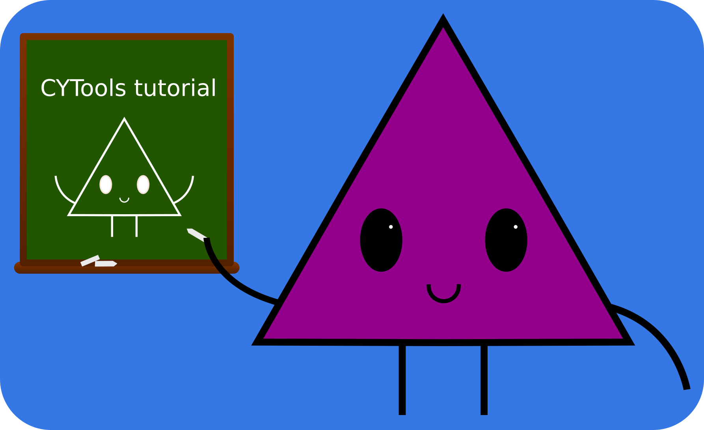
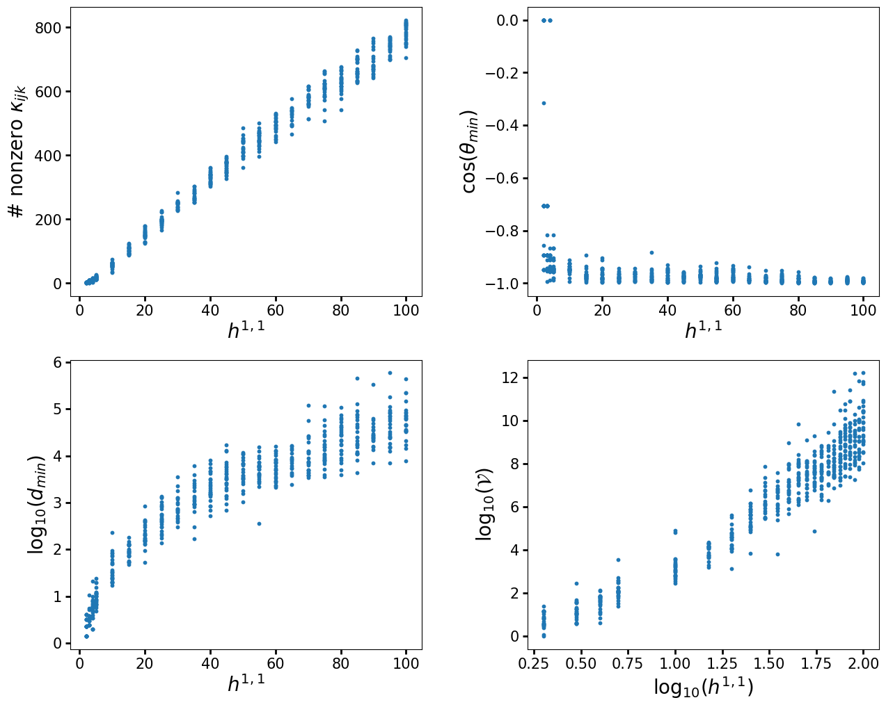
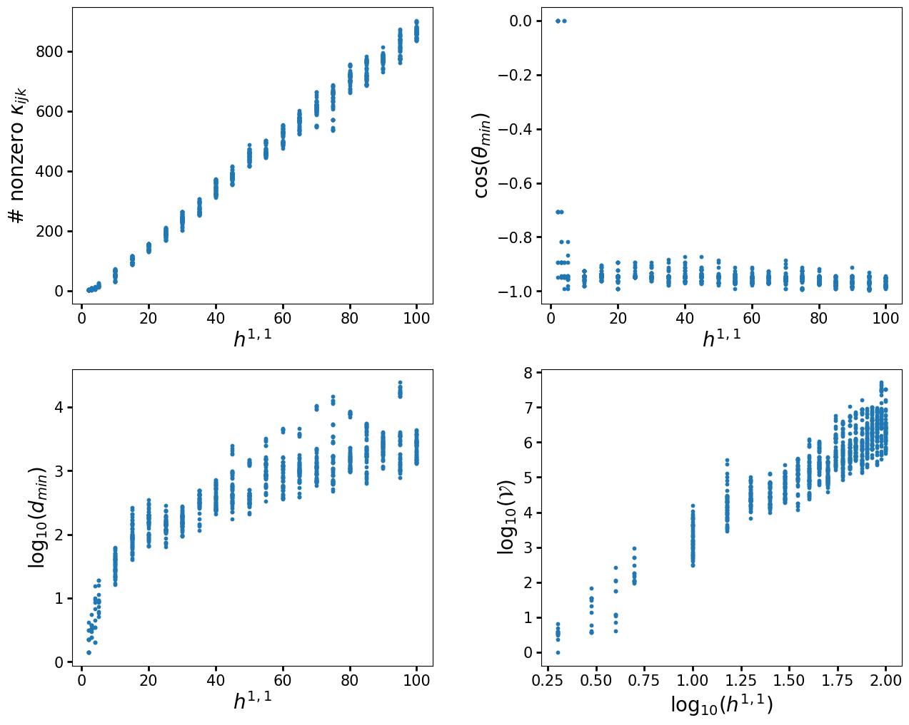

# Tutorial

<div align="center" markdown>
{ width="400" }
</div>

!!! tip

    This tutorial is available as a Jupyter notebook that you can download at the link below so that you can follow along. In the web version, we show the output of the code as comments at the bottom of each block, so that it can be copied and pasted without extra characters. Additionally, every code block on the website (not just the tutorial) has a button at its top right corner to copy its entire content.

    <div class="cy-buttons" markdown>
    [Download tutorial notebook](../files/tutorial.ipynb){ .md-button .md-button--primary download="tutorial.ipynb" }
    </div>

!!! note

    This tutorial is focused on showing how to use the functionality available in CYTools. For more detailed background about the underlying objects, and the mathematical and physical motivations for these computations, we refer the reader to the CYTools paper, [arXiv:2211.03823](https://arxiv.org/abs/2211.03823).

In this tutorial, we will look at the basics of the CYTools package, as well as show a realistic use case. Let us start with a brief overview of the available classes.

## Overview

The starting objects for most computations are the [`Polytope`](../documentation/polytope.md) and [`Cone`](../documentation/cone.md) classes. These can be imported as follows.

```python
from cytools import Polytope, Cone
```

!!! tip

    If you are following along in the notebook and are not familiar with Jupyter, you can run the code in a cell by selecting it and pressing ++shift+enter++.

Other important classes in this package are [`Triangulation`](../documentation/triangulation.md), [`ToricVariety`](../documentation/toricvariety.md), and [`CalabiYau`](../documentation/calabiyau.md). These should generally not be constructed directly by the user. Instead, objects of these classes are obtained from more fundamental objects with designated functions.

Let us take a brief look at each of the classes and how to perform computations with them. Afterwards, we will give a self-contained example of a realistic computation.

### Polytopes

First, let's take a look at the [`Polytope`](../documentation/polytope.md) class. A [`Polytope`](../documentation/polytope.md) object can be created by specifying a list of points whose convex hull defines it. Note that CYTools only supports lattice polytopes, so the points must have integer coordinates.

```python
p = Polytope([[1,0,0,0],[0,1,0,0],[0,0,1,0],[0,0,0,1],[-1,-1,-1,-1]])
```

We can print some information about the polytope as follows.

```python
print(p)
# A 4-dimensional reflexive lattice polytope in ZZ^4
```

The lattice points, boundary points, interior points, etc., can be computed using self-explanatory functions. For example, if we want the full list of lattice points of the polytope, we can obtain it as follows.

```python
p.points()
# array([[ 0,  0,  0,  0],
#        [-1, -1, -1, -1],
#        [ 0,  0,  0,  1],
#        [ 0,  0,  1,  0],
#        [ 0,  1,  0,  0],
#        [ 1,  0,  0,  0]])
```

As another example, if we want to find the 2-dimensional faces of the polytope, we can do so as follows.

```python
p.faces(d=2)
# (A 2-dimensional face of a 4-dimensional polytope in ZZ^4,
#  A 2-dimensional face of a 4-dimensional polytope in ZZ^4,
#  A 2-dimensional face of a 4-dimensional polytope in ZZ^4,
#  A 2-dimensional face of a 4-dimensional polytope in ZZ^4,
#  A 2-dimensional face of a 4-dimensional polytope in ZZ^4,
#  A 2-dimensional face of a 4-dimensional polytope in ZZ^4,
#  A 2-dimensional face of a 4-dimensional polytope in ZZ^4,
#  A 2-dimensional face of a 4-dimensional polytope in ZZ^4,
#  A 2-dimensional face of a 4-dimensional polytope in ZZ^4,
#  A 2-dimensional face of a 4-dimensional polytope in ZZ^4)
```

Since this polytope is reflexive, each face has a dual face in the dual polytope. The dual of a $d$-dimensional face of a 4-dimensional polytope is a $(3-d)$-dimensional face of the dual polytope. We can verify this as follows.

```python
f = p.faces(d=2)[0] # Try picking a different face
f.dual_face() in p.dual_polytope().faces(d=1)
# True
```

We can compute information relevant to Batyrev's construction of Calabi-Yau hypersurfaces when the polytope is reflexive and 4-dimensional. To avoid ambiguity, one must specify whether the polytope should be viewed as living in the $M$ lattice or the $N$ lattice.

```python
p.h11(lattice="N"), p.h21(lattice="N")
# (1, 101)
```

!!! tip

    To see the full list of available functions, you can type the name of the polytope (in this case `p`) followed by a period and then press ++tab++. This works for any kind of object! So if you want to see the available functions for `ToricVariety`, `CalabiYau`, or `Cone` objects you can do the same thing.

You can find the full documentation of the [`Polytope`](../documentation/polytope.md) class [here](../documentation/polytope.md).

#### Using the Kreuzer-Skarke database

CYTools provides two useful functions to work with the Kreuzer-Skarke (KS) database. We can import them as follows.

```python
from cytools import read_polytopes, fetch_polytopes
```

The first function reads polytopes from a file written in the format used by the KS database. The second function fetches polytopes directly from the database. For example, let's fetch 100 polytopes whose associated Calabi-Yau hypersurfaces have $h^{2,1}=7$.

```python
polys = fetch_polytopes(h21=7, lattice="N", limit=100)
print(len(polys))
# 100
```

By default, a list of polytopes is returned. When fetching a large number of polytopes, it is better to construct them one at a time as they are needed, so that they are not all kept in memory. This can be done by passing `as_list=False`, in which case a generator is returned instead.

```python
g = fetch_polytopes(h21=7, lattice="N", limit=100, as_list=False)
print(g)
# <generator object polytope_generator at 0x7f306eacaeb0>
```

We can get polytopes from the generator one at a time as follows.

```python
p1 = next(g)
p2 = next(g)
```

Or we can get all of the remaining polytopes as a list.

```python
l = list(g)
print(len(l))
# 98
```

In this example, the generator had a limit of 100 polytopes. Since it had already generated two polytopes in the previous cell, it only generated the remaining 98 when we constructed the list.

If you are not familiar with Python, it is worth noting that generators raise a `StopIteration` exception once they are exhausted. For this reason, if you are using the `next` function in your code it is usually necessary to wrap it in a `try`-`except` statement, as in the following example.

```python hl_lines="3 6"
g = fetch_polytopes(h21=1, lattice="N", limit=100, as_list=False)
for i in range(100):
    try:
        p = next(g)
        print(f"Fetched polytope {i}")
    except StopIteration:
        print(f"Iteration stopped at number {i}")
        break
# Fetched polytope 0
# Fetched polytope 1
# Fetched polytope 2
# Fetched polytope 3
# Fetched polytope 4
# Iteration stopped at number 5
```

More conveniently, generators (and lists) can be used in for-loops in the following way.

```python hl_lines="2"
g = fetch_polytopes(h21=1, lattice="N", limit=100, as_list=False)
for p in g:
    print(p)
# A 4-dimensional reflexive lattice polytope in ZZ^4
# A 4-dimensional reflexive lattice polytope in ZZ^4
# A 4-dimensional reflexive lattice polytope in ZZ^4
# A 4-dimensional reflexive lattice polytope in ZZ^4
# A 4-dimensional reflexive lattice polytope in ZZ^4
```

!!! tip

    The [`fetch_polytopes`][cytools.utils.fetch_polytopes] function can take many different parameters, and can even fetch 5-dimensional polytopes from the Schöller-Skarke database. To see more information about a function, you can write its name followed by a question mark, as follows. (This only works in Jupyter notebooks and IPython.)

```python
fetch_polytopes?
```

You can find the documentation of the [`fetch_polytopes`][cytools.utils.fetch_polytopes] function [here][cytools.utils.fetch_polytopes].

### Triangulations

Let us now look at how we can triangulate the polytopes. We start with the following polytope.

```python
p = Polytope([[1,0,0,0],[0,1,0,0],[0,0,1,0],[-3,-1,-1,0],[1,1,1,2],[-1,-1,1,-1],[-1,1,-1,-1]])
```

We can obtain a triangulation simply by using the following line.

```python
t = p.triangulate()
```

And we can print information about the triangulation as follows.

```python
print(t)
# A fine, regular, star triangulation of a 4-dimensional point configuration with 10 points in ZZ^4
```

For 4-dimensional reflexive polytopes, it defaults to constructing a fine, regular, star triangulation (FRST). Notice that it specifically tells us how many points there are in the triangulated point configuration. In this case, it has 10 points. Let us see how many lattice points the polytope contains.

```python
len(p.points())
# 11
```

This mismatch is due to the fact that, for 4-dimensional reflexive polytopes, the [`triangulate`][cytools.polytope.Polytope.triangulate] function ignores points interior to facets, as they correspond to toric divisors that do not intersect the Calabi-Yau hypersurface. When it is necessary to include the full set of points, one can do so as follows.

```python
p.triangulate(include_points_interior_to_facets=True)
# A fine, regular, star triangulation of a 4-dimensional point configuration with 11 points in ZZ^4
```

Other options, such as the heights, whether to make it star, the backend, etc., can be specified as well. In the following line, we specify a height vector, ask for the triangulation to be turned into a star triangulation, and specify CGAL as the software that will perform the triangulation.

```python
t = p.triangulate(heights=[0,3,7,1,9,1,1,1,3,2,2], make_star=True, backend="cgal")
```

Various properties of the triangulation can be accessed by self-explanatory functions. For example, we can find the list of simplices as follows.

```python
t.simplices()
# array([[0, 1, 2, 3, 6],
#        [0, 1, 2, 3, 9],
#        [0, 1, 2, 4, 7],
# ** output truncated **
```

Some functionality relies on other software that is installed as a dependency. For example, finding the triangulations that differ by a bistellar flip uses TOPCOM.

```python
t.neighbor_triangulations()
# [A fine, non-star triangulation of a 4-dimensional point configuration with 10 points in ZZ^4,
#  A non-fine, star triangulation of a 4-dimensional point configuration with 10 points in ZZ^4,
#  A fine, non-star triangulation of a 4-dimensional point configuration with 10 points in ZZ^4,
#  A non-fine, star triangulation of a 4-dimensional point configuration with 10 points in ZZ^4,
#  A fine, star triangulation of a 4-dimensional point configuration with 10 points in ZZ^4,
#  A fine, star triangulation of a 4-dimensional point configuration with 10 points in ZZ^4]
```

A quick way to generate random triangulations is to pick random heights around the heights of the Delaunay triangulation. This can be done with the [`random_triangulations_fast`][cytools.polytope.Polytope.random_triangulations_fast] function.

```python
triangs_gen = p.random_triangulations_fast(N=100)
```

By default, a generator is returned instead of a list of triangulations, so that the triangulations are only constructed as they are needed.

!!! warning

    The above method to find triangulations is fast, but does not produce a fair sample of triangulations. A fair sample can be obtained with the [`random_triangulations_fair`][cytools.polytope.Polytope.random_triangulations_fair] function, which is much slower.

You can find the full documentation of the [`Triangulation`](../documentation/triangulation.md) class [here](../documentation/triangulation.md).

### Toric Varieties

We can interpret star triangulations as defining a toric fan, and construct the associated toric variety. We can do this as follows.

```python
p = Polytope([[1,0,0,0],[0,1,0,0],[0,0,1,0],[-1,1,1,0],[0,-1,-1,0],
              [0,0,0,1],[1,-2,1,1],[-2,2,0,-1],[1,0,-1,-1]])
t = p.triangulate()
v = t.get_toric_variety()
```

Basic information can be printed as follows.

```python
print(v)
# A simplicial compact 4-dimensional toric variety with 31 affine patches
```

Various properties of the toric variety can be accessed by self-explanatory functions. For example, its intersection numbers and Mori cone can be computed as follows.

```python
intnums = v.intersection_numbers()
mori_cone = v.mori_cone()
```

You can find the full documentation of the [`ToricVariety`](../documentation/toricvariety.md) class [here](../documentation/toricvariety.md).

### Calabi-Yaus

Let's now get to the class of most interest. A [`CalabiYau`](../documentation/calabiyau.md) object can be obtained from a triangulation or from a toric variety as follows.

```python
p = Polytope([[1,0,0,0],[0,1,0,0],[0,0,1,0],[-1,1,1,0],[0,-1,-1,0],[0,0,0,1],
              [1,-2,1,1],[-2,2,0,-1],[1,0,-1,-1]])
t = p.triangulate()
v = t.get_toric_variety()
cy = v.get_cy()
cy = t.get_cy() # This is equivalent to the line above, but you can get it directly from the triangulation
```

Basic information can be printed as follows.

```python
print(cy)
# A Calabi-Yau 3-fold hypersurface with h11=7 and h21=23 in a 4-dimensional toric variety
```

Various properties of the CY can be accessed by self-explanatory functions. For example, its intersection numbers and the inherited part of the Mori cone from toric geometry can be computed as follows.

```python
intnums = cy.intersection_numbers()
mori_cone = cy.toric_mori_cone()
```

You can find the full documentation of the [`CalabiYau`](../documentation/calabiyau.md) class [here](../documentation/calabiyau.md).

### Cones

Lastly, let's briefly look at the [`Cone`](../documentation/cone.md) class. Cones can be constructed by specifying either a set of generating rays or a set of inward-pointing normals of the hyperplanes that bound them.

```python
c1 = Cone([[0,1],[1,1]])
c2 = Cone(hyperplanes=[[0,1],[1,1]])
```

Let us look at the (toric) Mori cone of the above Calabi-Yau.

```python
mc = cy.toric_mori_cone()
```

We can print some information about it as follows.
```python
print(mc)
# A 7-dimensional rational polyhedral cone in RR^12 generated by 36 rays
```

Note that by default the Mori cone is given in a basis-independent way, as an $h^{1,1}$-dimensional cone in an $(h^{1,1}+\dim(V)+1)$-dimensional space, where $V$ is the ambient toric variety. We can tell CYTools to use a basis of curves with the `in_basis=True` parameter. For more information on how to set a basis of curves or divisors, see [`set_curve_basis`][cytools.toricvariety.ToricVariety.set_curve_basis] or [`set_divisor_basis`][cytools.toricvariety.ToricVariety.set_divisor_basis].

The Kähler cone can be computed with the designated function, or by taking the dual of the Mori cone in a basis of curves.

```python
kc = cy.toric_kahler_cone()
kc = cy.toric_mori_cone(in_basis=True).dual() # This line is equivalent to the previous one, but it is less direct
```

CYTools computes duals lazily: no computation is done, and instead the definition of the cone is dualized. This can be seen by printing the information and noticing that the cone is defined in terms of hyperplane normals instead of generating rays.

```python
print(kc)
# A rational polyhedral cone in RR^7 defined by 36 hyperplanes
```

However, we can still find the generating rays if desired, although this computation becomes much more difficult as the dimension increases.

```python
kc.rays()
# array([[ 0,  2,  2,  0,  3,  1,  1],
#        [ 0,  6, 12,  3,  9,  3,  5],
#        [ 1,  1,  2,  1,  2,  1,  1],
# ** output truncated **
```

After finding the rays, the definition of the cone is updated to show the number of generating rays.

```python
print(kc)
# A 7-dimensional rational polyhedral cone in RR^7 generated by 18 rays
```

As with other classes, there are numerous functions available for the [`Cone`](../documentation/cone.md) class. For example, we can take intersections, find lattice points, and various other things. We can also find the tip of the stretched Kähler cone as follows. (Recall that the stretched cone is the region of points $x$ in the cone satisfying $h\cdot x\geq c$ for every hyperplane normal $h$, here with $c=1$, and its tip is the point in this region with the smallest norm.)

```python
tip = kc.tip_of_stretched_cone(1)
print(f"The tip is at {tip}")
print(f"The minimum of h.x over the hyperplane normals h is {min(kc.hyperplanes().dot(tip))}")
# The tip is at [ 2. 10. 12.  1. 14.  5.  5.]
# The minimum of h.x over the hyperplane normals h is 0.9999999999999876
```

You can find the full documentation of the [`Cone`](../documentation/cone.md) class [here](../documentation/cone.md).

## Illustrative example

Let us now look at a full example computation. For this, let's reproduce some of the results of the paper __The Kreuzer-Skarke Axiverse__ \[[arXiv:1808.01282](https://arxiv.org/abs/1808.01282)\]. In particular, we will reproduce figures 1, 3, 4, and 8(a). We will use a much smaller set of polytopes so that the code only takes a few minutes to run. Consequently, the spread of the distributions will not be as large, but it is clear that they match. To more closely match the procedure used in the paper, we will only construct a single triangulation per polytope using TOPCOM. Afterwards, we will also show how to sample multiple triangulations of each polytope.

We start by defining a function that computes the quantities of interest for a Calabi-Yau, and a function that plots them.

```python
import matplotlib.pyplot as plt
import numpy as np

def compute_data(cy):
    """Compute the quantities shown in the plots for a Calabi-Yau."""
    # The number of nonzero intersection numbers in a basis of divisors
    n_intnums = len(cy.intersection_numbers(in_basis=True))
    # The cosine of the smallest angle between two rays of the Mori cone
    mori_rays = cy.toric_mori_cone(in_basis=True).rays()
    unit_rays = mori_rays / np.linalg.norm(mori_rays, axis=1, keepdims=True)
    cos_angles = unit_rays @ unit_rays.T
    costhetamin = cos_angles[np.triu_indices(len(unit_rays), k=1)].min()
    # The distance to the tip of the stretched Kähler cone, and the volume of
    # the Calabi-Yau at that point
    tip = cy.toric_kahler_cone().tip_of_stretched_cone(1)
    dmin = np.linalg.norm(tip)
    volume = cy.compute_cy_volume(tip)
    return n_intnums, costhetamin, np.log10(dmin), np.log10(volume)

def plot_data(h11_list, data):
    """Plot the quantities computed with compute_data against h11."""
    xdata = [h11_list]*3 + [np.log10(h11_list)]
    xlabels = [r"$h^{1,1}$"]*3 + [r"$\log_{10}(h^{1,1})$"]
    ylabels = [r"# nonzero $\kappa_{ijk}$", r"$\cos(\theta_{min})$",
               r"$\log_{10}(d_{min})$", r"$\log_{10}(\mathcal{V})$"]
    fig, axes = plt.subplots(2, 2, figsize=(15, 12))
    for ax, x, y, xlabel, ylabel in zip(axes.flat, xdata, zip(*data), xlabels, ylabels):
        ax.scatter(x, y, s=10)
        ax.set_xlabel(xlabel, size=20)
        ax.set_ylabel(ylabel, size=20)
        ax.tick_params(labelsize=15, width=2, length=5)
    fig.subplots_adjust(wspace=0.3, hspace=0.22)
```

!!! tip

    If you are not familiar with Matplotlib, you can find tutorials and documentation at [matplotlib.org](https://matplotlib.org/).

Now we perform the scan. This code should take about 5 minutes to run.

```python
from cytools import fetch_polytopes

# These are the settings for the scan.
# We scan h11=2,3,4,5,10,15,...,100
# For each h11 we take 25 polytopes
h11s = [2,3,4] + list(range(5,105,5))
n_polys = 25

# These are the lists where we will save the data
h11_list = []
data = []

for h11 in h11s:
    print(f"Processing h11={h11}", end="\r")
    for p in fetch_polytopes(h11=h11, lattice="N", favorable=True, limit=n_polys):
        # Here we use a single triangulation constructed using TOPCOM,
        # to more closely reproduce the data in the paper.
        t = p.triangulate(backend="topcom")
        h11_list.append(h11)
        data.append(compute_data(t.get_cy()))
print("Finished processing all h11s!")
print(f"Scanned through {len(h11_list)} CY hypersurfaces.")

plot_data(h11_list, data)
```



As we previously mentioned, in this example we restricted to finding only a single triangulation per polytope with TOPCOM, as this is how the original analysis was done. However, with CYTools we can do better, as there are functions to sample triangulations of polytopes. Let us redo the above computation, but now picking a small set of triangulations obtained by randomly picking heights, which is done by the [`random_triangulations_fast`][cytools.polytope.Polytope.random_triangulations_fast] function. Keep in mind that this does not produce a fair sample of triangulations. For a fair sample, one should use the much slower [`random_triangulations_fair`][cytools.polytope.Polytope.random_triangulations_fair] function. However, for demonstration purposes, as well as for other applications like machine learning, a fast sampling of triangulations is sufficient.

Again, this code should only take about 5 minutes to run.

```python
# These are the settings for the scan.
# We scan h11=2,3,4,5,10,15,...,100
# For each h11 we take 10 polytopes,
# and 5 random triangulations for each polytope
h11s = [2,3,4] + list(range(5,105,5))
n_polys = 10
n_triangs = 5

# These are the lists where we will save the data
h11_list = []
data = []

for h11 in h11s:
    print(f"Processing h11={h11}", end="\r")
    for p in fetch_polytopes(h11=h11, lattice="N", favorable=True, limit=n_polys):
        # Here we take a random set of triangulations by picking random heights.
        # We use max_retries=5 so that the generation doesn't take too long.
        for t in p.random_triangulations_fast(N=n_triangs, max_retries=5, progress_bar=False):
            h11_list.append(h11)
            data.append(compute_data(t.get_cy()))
print("Finished processing all h11s!")
print(f"Scanned through {len(h11_list)} CY hypersurfaces.")

plot_data(h11_list, data)
```



The above example shows the power of CYTools. The original paper required very significant effort to assemble the code for the analysis, as it required downloading the KS database, performing some computations in SageMath, then performing some extra computations in Mathematica, and finally using a variety of scripts to gather all the data. Now, anyone can perform the full analysis with a few lines of code in CYTools. Although we only took a small number of polytopes in this example, one could easily increase the range of the scan and even surpass the statistics of the original paper by running the computation on a standard laptop overnight.

This concludes the brief tutorial. We have some additional [advanced usage instructions](advanced.md) for people who intend to perform large-scale computations with CYTools. For a full list of available classes and functions, please explore the [documentation](../documentation/index.md).
