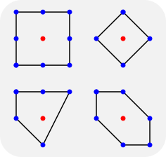
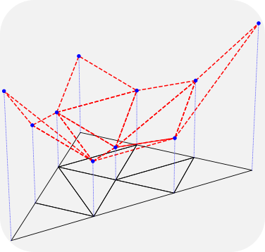
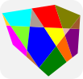

<picture>
  <source media="(prefers-reduced-motion: reduce)" srcset="img/titleimage.svg">
  
</picture>

A software package for analyzing Calabi-Yau manifolds

[Get Started](getting-started/index.md){ .md-button .cy-hero__button }

{ .cy-feature__image }

### Fast algorithms

CYTools includes fast algorithms to handle and triangulate reflexive polytopes
and obtain the data of the associated Calabi-Yau hypersurfaces.

{ .cy-feature__image }

### Powerful and robust

CYTools can be used to explore the entirety of the Kreuzer-Skarke database,
even at the largest Hodge numbers.

{ .cy-feature__image }

### Easy to use

CYTools is easy to install and use. We provide extensive documentation and all
the code is open-source.

#### Getting Started

- [Installation](getting-started/index.md)
- [Tutorial](getting-started/tutorial.md)

#### Docs

- [Documentation](documentation/index.md)
- [License](documentation/license.md)

#### More

- [About CYTools](about.md)
- [GitHub](https://github.com/LiamMcAllisterGroup/cytools)
- [Liam McAllister Group](https://liammcallistergroup.com)

